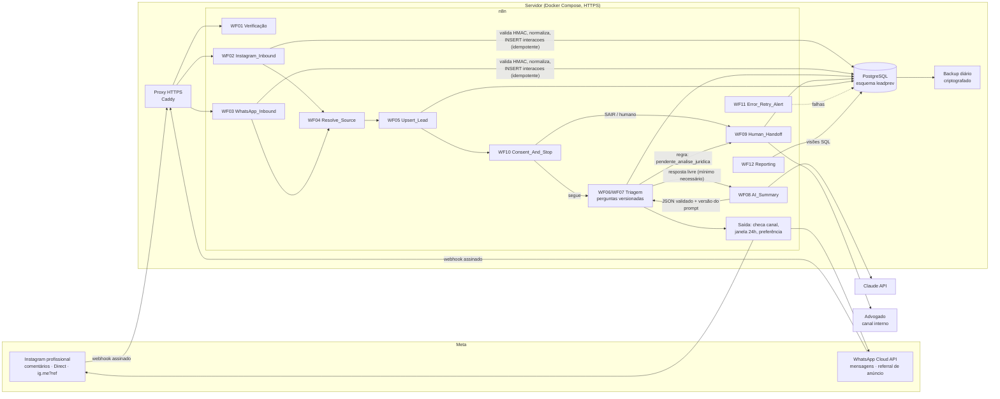
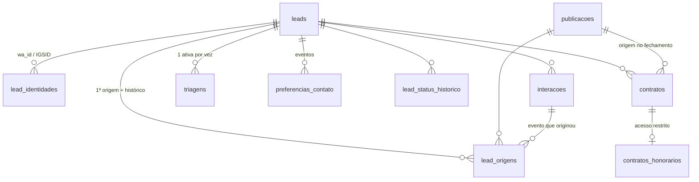

# Fase 1 — Descoberta e validação

Projeto: Gerador de Leads Previdenciários — Fernando Oliveira Advocacia
Foco inicial: aposentadoria rural e salário-maternidade rural.
Data: 22/10/2026. Situação: **proposta para aprovação** (nada aqui foi colocado em produção).

Legenda de confiabilidade usada neste documento:

- ✅ **Confirmado**: está na documentação oficial (a fonte está citada).
- ⚠️ **A validar**: a fonte é de terceiros, a documentação oficial é ambígua ou o comportamento precisa de teste na conta real.
- ❓ **Desconhecido**: não encontrei a informação; será testado antes de virar dependência.

> Observação: neste ambiente o acesso direto a developers.facebook.com foi bloqueado. As citações da Meta vieram de buscas que retornaram trechos das páginas oficiais. Antes da Fase 3, cada item ⚠️ será conferido na conta real do escritório.

---

## 0. Análise do que já existe no repositório

A branch `main` tem um **protótipo em Node.js + SQLite** (`src/`), feito antes desta especificação. Ele demonstra o fluxo e tem partes reaproveitáveis, mas **não atende à especificação** e **não deve receber mensagens de pessoas reais**.

### O que pode ser reaproveitado

| Item | Onde | Reuso |
|---|---|---|
| Verificação do webhook (GET `hub.challenge`) | `src/server.js` | Lógica idêntica no WF01 |
| Validação HMAC `X-Hub-Signature-256` sobre o corpo bruto, com comparação em tempo constante | `src/meta.js` (`assinaturaValida`) | Código do nó Code do n8n ou do gateway (D1) |
| Deduplicação por ID do evento | `src/db.js` (`jaProcessado`) | Substituída pelo índice único de `interacoes` |
| Extração de código `(ref:XXX)` do texto do wa.me | `src/campanhas.js` | WF04 (formato do código muda para `AR001`) |
| Leitura do `referral` de anúncios Click-to-WhatsApp | `src/whatsapp.js` | WF03/WF04 |
| Saída estruturada da IA validada por schema (Zod/JSON Schema) | `src/ia.js` | WF08 (schema novo, da seção 10 da especificação) |
| Testes unitários (assinatura, código, deduplicação) | `test/` | Viram casos do plano de testes |

### Lacunas em relação à especificação

| # | Requisito da especificação | Situação no protótipo | Gravidade |
|---|---|---|---|
| L1 | n8n + PostgreSQL | Node.js + SQLite | Arquitetural |
| L2 | Foco em aposentadoria rural e salário-maternidade rural | Prompt genérico (BPC, auxílio-doença, pensão etc.) | Alta |
| L3 | **A IA não decide; regras e humano decidem** (princípio 7) | A IA define `status`, `encaminhar_advogado` e `optout` | **Alta** |
| L4 | Uma pergunta por vez | O prompt permite "uma ou duas perguntas" | Média |
| L5 | Origem inicial preservada + histórico + método + confiança | Só `origem_ref` (COALESCE); sem histórico, método ou confiança | Alta |
| L6 | Comentário não autoriza mensagem promocional (princípio 5) | Comentário com palavra-chave dispara DM com link do WhatsApp | **Alta: decisão D5** |
| L7 | Sem envio não solicitado; homologação antes de envio real | Existe `npm run followup` com template | **Alta: desativar** |
| L8 | Consentimento/preferência com finalidade, versão, revogação | Um booleano `consentimento_lgpd`, decidido pela IA | Alta |
| L9 | Pedido de parar respeitado e registrado de forma determinística | Detectado só pela IA | Alta |
| L10 | Logs sem dados pessoais | `console.log` imprime o resumo do caso e o corpo das mensagens no modo simulação | Alta |
| L11 | Minimização: não guardar conversa integral sem necessidade | Guarda todo o texto, sem prazo de retenção | Alta: decisão D7 |
| L12 | Minimização no envio à IA | Envia até 40 mensagens de histórico, inclusive dados de saúde | Média |
| L13 | Retentativas e tratamento de falha | Sem fila; temporizadores em memória se perdem num reinício; falha de envio só vai para o log | Alta |
| L14 | Sem credenciais ou modo inseguro em produção | Sem token, o envio vira "simulação" silenciosa e a assinatura passa em `DRY_RUN` | Média |
| L15 | Tabelas `publicacoes`, `triagens`, `contratos`, `auditoria` | Inexistentes | Alta |
| L16 | Versão do fluxo e do prompt registrada | Inexistente | Média |
| L17 | Acesso restrito ao painel | Token aceito na query string (fica em logs de proxy) | Média |
| L18 | Testes de falha de API, privacidade, handoff | Só testes unitários | Média |

**Recomendação:** congelar o protótipo (mover para `prototipo-node/` como referência, decisão D1) e construir o MVP conforme esta especificação, reaproveitando os trechos da primeira tabela.

---

## 1. Arquitetura



Decisões embutidas no desenho:

1. **O webhook responde 200 logo depois de gravar o evento.** O processamento continua de forma assíncrona; a reentrega da Meta é absorvida pelo índice único `interacoes (canal, direcao, id_externo)`.
2. **A IA só interpreta e resume.** Quem avança etapa, muda status, pausa a automação e encaminha ao advogado são regras explícitas no n8n e no banco. Exemplos: "todas as perguntas obrigatórias respondidas → `pendente_analise_juridica`"; "contradição detectada → revisão humana".
3. **Pedido de parar ou de atendimento humano é detectado antes da IA**, por palavras-chave determinísticas (SAIR, PARAR, ATENDENTE, HUMANO…). A IA serve só como segunda checagem.
4. **Toda saída passa por um único ponto.** Esse ponto confere: automação pausada? preferência revogada? janela de 24h aberta? canal permitido? Sem aprovação explícita (Fase 6), o ponto de saída fica em **modo homologação**: só envia para números da lista de teste.

---

## 2. Requisitos e dependências da Meta

### 2.1 Instagram

| # | Requisito / limitação | Status | Fonte |
|---|---|---|---|
| I1 | Conta profissional; para receber webhooks de comentários, a conta dona da mídia precisa ser **pública** | ✅ | [Webhooks do Instagram](https://developers.facebook.com/docs/instagram-platform/webhooks) |
| I2 | Permissões (Instagram Login): `instagram_business_basic`, `instagram_business_manage_messages`, `instagram_business_manage_comments` | ✅ | [Private replies](https://developers.facebook.com/docs/instagram-platform/private-replies/) |
| I3 | O app precisa estar **Live** para a Meta enviar webhooks | ✅ | [Webhooks do Instagram](https://developers.facebook.com/docs/instagram-platform/webhooks) |
| I4 | **Advanced Access** para receber webhooks de `comments`. A documentação diz que Standard Access basta para contas do próprio desenvolvedor, o que é o nosso caso, mas em outro trecho exige Advanced Access para `comments` | ⚠️ conflito: testar | [Webhooks do Instagram](https://developers.facebook.com/docs/instagram-platform/webhooks) |
| I5 | O webhook de comentário traz `media.id` (o post), o ID do comentário, o texto e o autor. **IDs de álbum não vêm.** Comentários em Live só chegam durante a transmissão | ✅ | [Webhooks do Instagram](https://developers.facebook.com/docs/instagram-platform/webhooks) |
| I6 | **Resposta privada a comentário**: uma única mensagem por comentário, em até 7 dias; novas mensagens só depois que a pessoa responder, dentro de 24h. Vai para "Solicitações" se a pessoa não segue a conta | ✅ | [Private replies](https://developers.facebook.com/docs/instagram-platform/private-replies/) |
| I7 | Automação no Direct só até 24h depois da última mensagem da pessoa. A tag `HUMAN_AGENT` (até 7 dias, só para atendimento humano) exige App Review próprio | ✅ | [Messenger: enviar mensagens](https://developers.facebook.com/docs/messenger-platform/send-messages) |
| I8 | **Link `ig.me/m/<usuario>?ref=<codigo>`** gera o evento `messaging_referral` com `ref` (até 2.083 caracteres: letras, números, `-`, `_`, `=`). Para conversas novas, exige **Ice Breakers** configurados | ⚠️ há relato de que o `ref` não chega: testar | [ig.me links](https://developers.facebook.com/documentation/instagram-platform/instagram-api-with-instagram-login/messaging-api/ig-me), [relato](https://zernio.featurebase.app/p/affiliate-attribution-across-instagram-facebook-messenger-whatsapp) |
| I9 | Uma DM comum **não informa de qual post a pessoa veio**. Sem `ref`, story reply ou código digitado, a origem é `unknown` | ✅ (por ausência no payload) | idem I8 |
| I10 | Webhooks assinados com `X-Hub-Signature-256` (HMAC-SHA256 do corpo bruto com o App Secret). A Meta calcula sobre o payload com unicode escapado, então é preciso usar os **bytes recebidos**, nunca o JSON re-serializado | ✅ | [Webhooks da Meta](https://developers.facebook.com/docs/messenger-platform/webhooks) |
| I11 | Limite de taxa das respostas privadas (750/h ou 200/h citados por terceiros) | ❓ irrelevante no piloto | — |

### 2.2 WhatsApp (Cloud API)

| # | Requisito / limitação | Status | Fonte |
|---|---|---|---|
| W1 | Conta WhatsApp Business (WABA) no Business Manager, número dedicado e app com o produto WhatsApp | ⚠️ conhecimento geral: conferir no cadastro | — |
| W2 | Permissões `whatsapp_business_messaging` e `whatsapp_business_management`; token de **Usuário do Sistema** para produção | ⚠️ confirmar na configuração | — |
| W3 | Texto livre só na **janela de 24h** depois da última mensagem do usuário. Fora dela, só template aprovado | ✅ | [Preços (terceiro)](https://respond.io/help/whatsapp/whatsapp-pricing) |
| W4 | Cobrança **por mensagem de template** desde 01/07/2025. Mensagens de serviço (texto livre na janela) sem custo; templates de utilidade dentro da janela sem custo; resposta a anúncio Click-to-WhatsApp abre janela gratuita de 72h | ⚠️ fontes de terceiros: conferir a página oficial de preços para o Brasil | [YCloud](https://www.ycloud.com/blog/whatsapp-api-pricing-update), [respond.io](https://respond.io/help/whatsapp/whatsapp-pricing) |
| W5 | **Opt-in obrigatório** antes de mensagens iniciadas pela empresa, explícito quanto ao tipo de mensagem | ⚠️ política oficial: conferir | [360dialog](https://docs.360dialog.com/docs/waba-management/capacity-quality-rating-and-messaging-limits) |
| W6 | Limite inicial de 250 conversas **iniciadas pela empresa** por 24h; conversas iniciadas pelo usuário não contam. Nome de exibição aprovado depende da verificação da empresa | ⚠️ | [360dialog](https://docs.360dialog.com/docs/waba-management/capacity-quality-rating-and-messaging-limits) |
| W7 | Mensagem vinda de anúncio Click-to-WhatsApp traz `referral` com `source_id`, `source_type` (`ad` ou `post`), `source_url`, `ctwa_clid` e, mais recentemente, `ref`. `ctwa_clid` some em anúncios no Status e pode vir vazio | ✅ | [Webhook messages/text](https://developers.facebook.com/documentation/business-messaging/whatsapp/webhooks/reference/messages/text), [Welcome sequences](https://developers.facebook.com/documentation/business-messaging/whatsapp/ctwa/welcome-message-sequences/) |
| W8 | Link `wa.me/<numero>?text=` só **pré-preenche** o texto: a pessoa pode apagar o código. O código só vale como origem quando chega na mensagem enviada | ✅ (comportamento do link) | Especificação, seção 5 |
| W9 | **Coexistência**: o mesmo número no app WhatsApp Business e na Cloud API. Só sincroniza mensagens novas, o app precisa ser aberto periodicamente e não há confirmação de que funcione no Brasil | ⚠️ | [Woztell](https://support.woztell.com/portal/en/kb/articles/coexistence-whatsapp), [seven.io](https://help.seven.io/en/whatsapp/whatsapp-coexistence) |

### 2.3 Outras dependências

| # | Item | Status | Fonte |
|---|---|---|---|
| X1 | **API do Claude é separada da assinatura do Claude.ai.** Exige conta em console.anthropic.com com cobrança própria | ✅ | [Retenção de dados da API](https://platform.claude.com/docs/en/manage-claude/api-and-data-retention) |
| X2 | Entradas e saídas da API apagadas em até 30 dias por padrão; retenção zero (ZDR) só por acordo; uso sinalizado por violação de política pode ficar retido por mais tempo | ✅ | [Retenção (API)](https://platform.claude.com/docs/en/manage-claude/api-and-data-retention), [Central de privacidade](https://privacy.claude.com/en/articles/7996866-how-long-do-you-store-personal-data) |
| X3 | Uso de dados da API para treinamento | ⚠️ trecho cortado na busca: ler a página antes de decidir | [Retenção (API)](https://platform.claude.com/docs/en/manage-claude/api-and-data-retention) |
| X4 | Opção "Raw Body" do nó Webhook do n8n, necessária para validar o HMAC | ⚠️ testar na Fase 2; alternativa em D1 | — |

---

## 3. Decisões pendentes

| # | Decisão | Opções | Recomendação |
|---|---|---|---|
| **D1** | Orquestração | (a) n8n + PostgreSQL, como na especificação; (b) manter o serviço Node; (c) n8n + um "gateway" Node mínimo só para validar a assinatura | **(a)**. Se o teste X4 falhar, **(c)**. Congelar o protótipo em `prototipo-node/` |
| **D2** | Hospedagem | VPS com Docker Compose (n8n, Postgres, Caddy) / n8n Cloud + Postgres gerenciado | VPS pequena com Docker Compose: menor custo e controle dos dados. Preciso do seu orçamento mensal |
| **D3** | API do Instagram | Instagram Login (`graph.instagram.com`) / Facebook Login (Página) | Instagram Login, salvo se você já usa uma Página com o Business Manager |
| **D4** | Número do WhatsApp | Número novo dedicado / coexistência com o número atual | **Número novo** no piloto (coexistência no Brasil não confirmada, W9) |
| **D5** | **Resposta privada a comentário** | (a) não usar: só link e `ig.me`; (b) usar só quando o post pedir expressamente ("comente QUERO para receber…"), com **uma mensagem informativa** que pergunta se a pessoa quer continuar, sem link comercial e sem nova mensagem se não houver resposta | Decisão ética sua (princípio 5 e Provimento 205/2021). Sugiro **(b)** só no piloto, revisando o texto |
| **D6** | Condução da triagem | (a) roteiro fixo e versionado; a IA só interpreta a resposta da etapa e resume; (b) a IA conduz livremente, como no protótipo | **(a)**, exigido pelos princípios 7 e 10 |
| **D7** | Retenção do texto das mensagens | Não guardar / guardar por N dias e apagar (`expurgar_conteudo_expirado`) / guardar enquanto o caso estiver ativo | Guardar por **90 dias** e manter só a triagem estruturada. Prazo a definir por você |
| **D8** | Bases legais (LGPD) por tratamento | Ver seção 12 da especificação | Definição sua. O esquema já registra `base_legal` e `texto_versao` |
| **D9** | Modelo de IA | Claude via API (padrão `claude-opus-5-5`; modelos menores após medir a qualidade) | Começar pelo padrão e medir o custo por triagem no piloto. Avaliar pedido de ZDR (X2) |
| **D10** | Canal interno de handoff | E-mail sem dados sensíveis + link do painel / WhatsApp pessoal (janela de 24h) / Telegram | E-mail com o mínimo de dados (nome, benefício, link) e detalhes só no painel autenticado |
| **D11** | Painel do MVP | NocoDB, Metabase ou Appsmith self-hosted / visões SQL + planilha | Metabase ou NocoDB sobre as visões `v_*`, com usuário só de leitura |
| **D12** | Mensagens fora da janela de 24h | Nenhuma no MVP / templates de utilidade com opt-in registrado | **Nenhuma no MVP** |
| **D13** | Atribuição no Direct | `ig.me?ref=` (depende de I8) / código digitado / registro manual | Testar I8 na Fase 3; manter o código digitado e o registro manual como alternativa |

---

## 4. Estrutura de pastas proposta

```
lead-prev/
├── README.md
├── .env.example                    # só nomes de variáveis, nunca valores reais
├── docs/
│   ├── fase-1-descoberta.md        # este documento
│   ├── decisoes/                   # ADRs: 001-orquestracao.md, 002-retencao.md ...
│   ├── lgpd/                       # inventário de dados, bases legais, aviso de privacidade, incidentes
│   └── runbooks/                   # backup/restauração, rotação de tokens, falha da Meta
├── db/
│   ├── migrations/                 # NNNN_nome.up.sql / NNNN_nome.down.sql
│   ├── seeds/                      # dados FICTÍCIOS para teste
│   └── tests/                      # testes SQL + run.sh
├── n8n/
│   ├── workflows/                  # WF01..WF12 em JSON importável (sem credenciais)
│   └── README.md                   # credenciais a configurar manualmente no n8n
├── triagem/
│   ├── fluxos/                     # aposentadoria_rural.v1.yaml, salario_maternidade_rural.v1.yaml
│   ├── prompts/                    # interpretar_resposta.v1.md, resumo.v1.md
│   └── schemas/                    # triagem.v1.schema.json (seção 10 da especificação)
├── infra/
│   ├── docker-compose.yml          # n8n + postgres + caddy
│   ├── Caddyfile
│   └── backup/                     # dump criptografado + teste de restauração
├── tests/
│   └── integracao/payloads/        # webhooks fictícios da Meta (válidos, duplicados, assinatura errada)
└── prototipo-node/                 # protótipo atual, congelado como referência (D1)
```

Nesta fase foram criados só `docs/`, `db/migrations/` e `db/tests/`. O resto entra nas fases seguintes.

---

## 5. Esquema PostgreSQL

Arquivos: [`db/migrations/0001_esquema_inicial.up.sql`](../db/migrations/0001_esquema_inicial.up.sql), com reversão em [`0001_esquema_inicial.down.sql`](../db/migrations/0001_esquema_inicial.down.sql). Esquema `leadprev`, PostgreSQL 16 ou superior.



| Tabela | Papel | Regras importantes |
|---|---|---|
| `publicacoes` | Cada post com código `AR001`, `SMR001`… | Código validado por regex; `(plataforma, id_externo)` único |
| `leads` | Pessoa no pipeline (9 estados da seção 7) | Telefone **não** é chave nem único; `automacao_pausada` exige motivo |
| `lead_identidades` | `(canal, id_externo)` único | **Deduplicação:** mesma identidade = mesmo lead. Canais diferentes **nunca** se unem sozinhos |
| `lead_origens` | Atribuição: canal, método, confiança, código informado, campanha | **Só inserção** (trigger). Uma `eh_primeira` por lead (índice parcial). Correção = nova linha `manual` com `corrige_origem_id` |
| `interacoes` | Eventos de entrada e saída, status de processamento, retentativas | `(canal, direcao, id_externo)` único = idempotência. Texto opcional, com data de expurgo (D7). Erro limitado a 500 caracteres e sanitizado |
| `triagens` | Benefício, respostas estruturadas, pendências, contradições, resumo, revisão humana | Uma triagem `em_andamento` por lead; registra `versao_fluxo`, `versao_prompt` e `modelo_ia` |
| `preferencias_contato` | Finalidade, estado, base legal, versão do texto, forma de revogação | **Só inserção**; o estado vigente fica em `v_preferencias_vigentes` |
| `contratos` / `contratos_honorarios` | Status e data; publicação considerada | Honorários em tabela separada para conceder acesso só ao advogado |
| `auditoria`, `lead_status_historico` | Rastreabilidade e métricas de tempo e conversão | Só inserção; o ator vem de `leadprev.ator` |

Funções e visões usadas pelos workflows:

- `upsert_lead(canal, id_externo, canal_entrada, ocorrido_em, nome, ator)`: cria ou retorna o lead com trava por identidade, seguro sob webhooks simultâneos.
- `registrar_origem(lead, canal, metodo, codigo, id_externo_publicacao, campanha, metadados, interacao, ator)`: normaliza o código, resolve a publicação, calcula a confiança e preserva a primeira origem.
- `expurgar_conteudo_expirado()`: aplica a retenção (D7).
- `v_origem_inicial`, `v_origem_efetiva`, `v_funil_por_publicacao`: base do WF12.

**Fora do esquema, de propósito:** CPF, documentos, laudos, extratos, dados bancários e conteúdo integral permanente das conversas.

---

## 6. Plano de testes do rastreamento por publicação

### 6.1 Testes de banco: executados ✅

`PGURL=postgres://... db/tests/run.sh` (cria um banco temporário, aplica, testa, reverte e reaplica). **Resultado da execução em PostgreSQL 16.15: 17/17 passaram.**

| ID | Cenário | Esperado |
|---|---|---|
| T01 | Mensagem com código conhecido (`AR001`) | Primeira origem, `link_code`, confiança alta |
| T02 | Mesmo evento entregue duas vezes | Uma única interação |
| T03 | Segunda origem diferente para o mesmo lead | Histórico com 2 linhas; a primeira continua `AR001` |
| T04 | Código inexistente (`XX999`) | Sem publicação, confiança baixa, código guardado como chegou |
| T05 | Sem informação de origem | `unknown` / `nenhuma`, explícito |
| T06 | Código `"  smr001 "` | Normalizado para `SMR001` |
| T07 | UPDATE/DELETE em `lead_origens` | Bloqueado |
| T08 | Correção manual | A origem efetiva muda; a inicial fica intacta |
| T09 | Mesma identidade de novo; mesmo número no Instagram | Não duplica; **não une** canais |
| T10 | Anúncio com `source_id` de post cadastrado | Resolve a publicação pelo ID externo |
| T11 | Status fora do pipeline; mudanças de status | Rejeitado; histórico registrado |
| T12 | Pausar a automação sem motivo | Rejeitado |
| T13 | Relatório por publicação | Contagens corretas, incluindo `DESCONHECIDA` |
| T14 | Expurgo de conteúdo vencido | Texto apagado, registro mantido |
| T15 | 20 webhooks simultâneos do mesmo contato | 1 lead, 20 origens, 1 primeira |
| T16–T17 | `down` e `up` de novo | Esquema removido e recriado |

### 6.2 Testes de integração: Fase 3, ainda não executados

Com payloads fictícios em `tests/integracao/payloads/`, enviados ao n8n de homologação:

| ID | Cenário | Esperado |
|---|---|---|
| I-01 | Webhook com assinatura válida | 200; interação gravada |
| I-02 | Assinatura inválida ou ausente | 401; nada gravado; alerta no WF11 |
| I-03 | Texto com acentos/emoji (verifica o HMAC sobre bytes brutos) | Assinatura aceita |
| I-04 | Reentrega do mesmo `wamid`/`mid` | Ignorada sem efeito colateral |
| I-05 | wa.me com código; pessoa apaga o código antes de enviar | Origem `unknown`, não `link_code` |
| I-06 | Código no meio do texto, minúsculo, com pontuação | Reconhecido |
| I-07 | Dois códigos na mesma mensagem | Primeiro reconhecido; o outro vai para os metadados; revisão |
| I-08 | Anúncio CTWA com `ctwa_clid` vazio ou ausente | Origem `ad_metadata` sem quebrar |
| I-09 | Comentário em post cadastrado | Origem `direct` pela `media.id` |
| I-10 | Comentário em post não cadastrado | Origem com confiança baixa e alerta para cadastrar o post |
| I-11 | `ig.me?ref=AR001` com conversa nova e existente (I8) | Documentar o comportamento real da Meta |
| I-12 | DM sem referência | `unknown` |
| I-13 | Lead já existente chega por outro post | Histórico cresce; primeira origem preservada |
| I-14 | Falha do PostgreSQL durante o webhook | Meta recebe erro → reentrega → sem duplicata |
| I-15 | Logs da execução | Sem telefone, texto da mensagem nem tokens |

### 6.3 Teste real controlado: Fase 6

Com 2 ou 3 contas de teste da equipe: cada caminho (wa.me, comentário, ig.me, DM sem código) feito manualmente, conferindo no `v_funil_por_publicacao`.

---

## 7. O que preciso de você

**Para iniciar a Fase 2 (infraestrutura):**

1. **Decisão D1**: n8n, como na especificação, ou outra opção?
2. **Hospedagem (D2)**: você já tem servidor ou VPS? Qual o teto de custo mensal?
3. **Domínio**: qual (sub)domínio vamos usar para o HTTPS (ex.: `leads.seudominio.com.br`)? Você tem acesso ao DNS?

**Para a Fase 3 (entrada e atribuição):**

4. **Business Manager**: existe? Está verificado (CNPJ do escritório)? Quem é o administrador?
5. **Instagram**: o @ é profissional e público? Está ligado a uma Página do Facebook? (define D3)
6. **WhatsApp (D4)**: número novo dedicado ou o atual? O número atual está no app WhatsApp Business?
7. **Decisão D5** sobre resposta privada a comentário.
8. **Lista inicial de publicações**: códigos, temas e URLs (pode começar com AR001, AR002, SMR001 e SMR002).

**Para a Fase 4 (triagem):**

9. **Validação jurídica** das perguntas das seções 8 e 9, e da mensagem de apresentação.
10. **Aviso de privacidade** publicado (URL), bases legais (D8) e prazo de retenção (D7).
11. **Conta na API da Anthropic** (console.anthropic.com), separada da assinatura do Claude.
12. **Canal de handoff (D10)** e quem mais da equipe vai acessar o sistema (perfis de acesso).

Nenhuma credencial deve ser enviada pelo chat. Quando chegarmos à Fase 2, elas vão direto para o arquivo `.env` do servidor ou para o cofre de credenciais do n8n.
